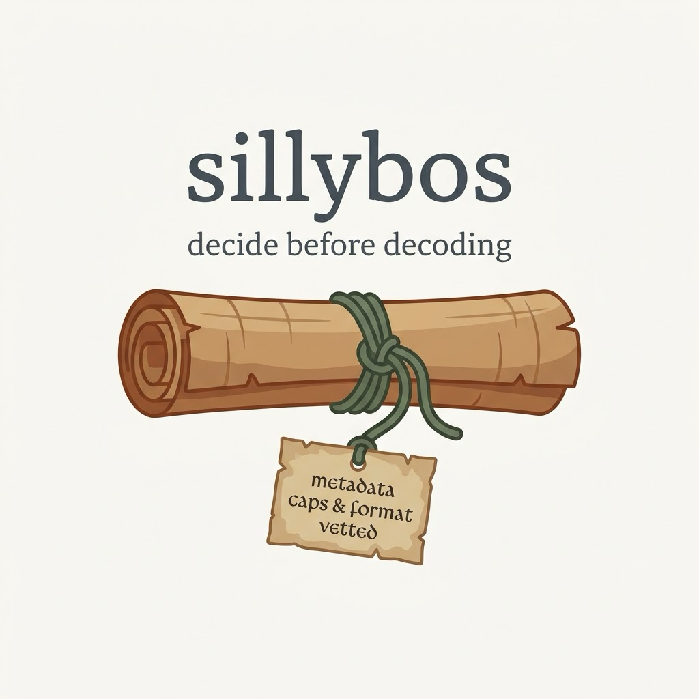

# sillybos



**Decide before decoding.** A σίλλυβος (*sillybos*; Latin *sittybus*) was
the little parchment tag that hung from a rolled scroll in an ancient
library, carrying its title and author, so that a reader could tell what a
scroll was without unrolling it. Cicero had them made for his books. This
library is that tag for the files a scanning or OCR pipeline is handed: it
reads the tag, and says whether the scroll should be unrolled at all.

It answers one narrow question, before any image library or PDF renderer
opens a file: *is this one of the formats I mean to read, within the limits
I expect, and if not, why?* It names the format from the file's first bytes,
whatever the file is called; reads the header of a JPEG, PNG or TIFF with a
few dozen lines of its own, never a decoder's; asks poppler's `pdfinfo`, in
a separate process with a time limit, how many pages a PDF has and how large
they are; and refuses, in a plain sentence, anything outside the policy you
give it.

> **Status: alpha.** The API is small and may still move. It is in use in
> [Tetrak OCR](https://tetrak.dev/), which is where it came from.

```bash
pip install sillybos            # the check; no dependencies
pip install 'sillybos[pillow]'  # plus open_checked(), which opens the file with Pillow
```

A PDF needs `pdfinfo` from poppler on the PATH (`brew install poppler`,
`apt install poppler-utils`). Anything that renders PDFs in Python already
has it.

## Why

Every program that reads scans hands each file to a decoder: Pillow for
images, poppler for PDFs, then an OCR engine. Decoders are large, old
programs that read complicated formats, and they have flaws. In October
2026, Pillow 13.0.0 fixed four serious ones at once. One of them
(CVE-2026-112900) ran commands on the computer when an EPS file was opened
and Ghostscript was installed; and a file's extension was no protection,
because Pillow decides what a file is from its contents, so a PostScript
file named `page.png` went straight to the PostScript reader.

The fixes to Pillow arrived; the lesson stays. A pipeline that opens files
it did not make should decide, from the file's own bytes and a policy of
its own, whether a decoder may have it, and should do that deciding with
code that is not itself a decoder.

## Use

```python
>>> from sillybos import check
>>> verdict = check("scans/page-012.png")
>>> verdict.ok
False
>>> verdict.reasons
('says PNG, is PostScript',)
```

```python
>>> verdict = check("scans/register.tif")
>>> verdict.ok, verdict.format, verdict.facts
(True, 'tiff', Facts(bytes=48213990, width=4960, height=7016, pages=32, max_pixels=34799360, encrypted=False))
```

`check` never raises for anything found *in* the file. A lying name, a
malformed header, a page too large and a thousand-page PDF are all reasons,
not exceptions, and a verdict carries every reason it found. `require` is
the same check for callers who would rather catch one exception:

```python
from sillybos import require, Refused

try:
    require(path)
except Refused as refusal:
    quarantine(path, refusal.verdict.reasons)
```

### The policy

```python
from sillybos import Policy, DEFAULT, STRICT, check

check(path)  # DEFAULT: a trusted laptop, your own scanner
check(path, STRICT)  # files from outside: smaller and shorter
check(path, Policy(formats={"tiff", "pdf"}, max_pages=50))
```

| Setting | `DEFAULT` | `STRICT` | What it bounds |
|---|---|---|---|
| `formats` | jpeg, png, tiff, pdf | the same | What may pass at all. Nothing else is ever allowed, whatever the policy says |
| `max_bytes` | 512 MiB | 128 MiB | The file. Checked before anything reads it |
| `max_pixels` | 89,478,485 | 50,000,000 | Any one page or frame, decoded. For a PDF page, at `render_dpi`. The default is Pillow's own decompression-bomb threshold, enforced here rather than left to a global |
| `max_pages` | 500 | 100 | Pages of a PDF, frames of a TIFF or animated PNG. Also bounds the header walk itself |
| `render_dpi` | 200 | 200 | What you will render PDF pages at, so a page's pixels are known before the renderer allocates them |
| `name_must_match` | yes | yes | Refuse a JPEG called `.png`. The readers would cope; the lie is what you want to know about |
| `allow_encrypted_pdf` | no | no | A scanned book is never encrypted |
| `pdfinfo_timeout` | 30 s | 30 s | How long `pdfinfo` may take before the file is refused |

The defaults were set from a real corpus of archival scans (largest page 39
million pixels at 600 dpi; longest book 166 pages) with room to spare. Set
yours the same way: from the largest real file you have, times two or three.

### With Pillow

```python
from sillybos.pillow import open_checked

with open_checked(
    path
) as image:  # checked first; then Image.open(path, formats=["JPEG", "PNG", "TIFF"])
    ...
```

`Image.open` takes a `formats` list, and a file outside it is never handed
to the other readers. `open_checked` runs the check, then opens with that
list set from the policy. That one argument is the whole of the October fix
for images, and it costs nothing; the check in front of it is what makes
the limits bite before Pillow allocates a pixel.

### The command

```bash
$ sillybos scans/*
ok       scans/page-001.tif  (TIFF, 4960x7016, 1 page, 1.6 MB)
refused  scans/page-002.png  says PNG, is PostScript
refused  scans/poster.jpg    a page of 1,200,000,000 pixels; the limit is 89,478,485
refused  scans/report.pdf    1,412 pages; the limit is 500
```

Exit status 0 when every file passed, 1 when any was refused, 2 when the
command could not do its job. `--strict`, `--formats`, `--max-pages`,
`--max-pixels`, `--max-bytes` and `--any-name` adjust the policy; `--json`
prints one object per line for a pipeline; `-q` prints only refusals.

## What it does, exactly

1. **Size**, from the file system. Over the limit, nothing reads the file
   but the next step.
2. **Format, from the first bytes.** JPEG, PNG, TIFF and PDF are the four
   it can pass. It also knows PostScript, GIF, BMP, WebP, HEIF, JPEG 2000,
   BigTIFF, Photoshop, OLE (FlashPix, old Office), zip, gzip, icons and
   XML, so that a refusal can say *what* the file is. Anything else is "an
   unknown format". Refused by name, and no reader of ours runs on it.
3. **Name against contents.** `says PNG, is JPEG`.
4. **The header**, with a reader of its own for each raster format: the
   dimensions from a JPEG's frame header, a PNG's `IHDR` (and `acTL` frame
   count), and every directory in a TIFF's chain, which is walked with a
   limit and a memory of where it has been, so that a chain that loops or
   points off the end of the file is a refusal, not a hang. Every read is
   bounded and every offset is checked against the file's size. For a PDF,
   `pdfinfo` reports the page count, whether it is encrypted and, if the
   count is within the limit, every page's size.
5. **The limits**, against what the header said.

## What it does not do

Say this plainly, because a security library carries an implied promise.

- **It does not protect against a flaw in the readers you *do* allow.** A
  crafted JPEG that exploits a bug in your JPEG decoder passes this check,
  because it is a JPEG of a sensible size. What this library removes is the
  attack surface of every format you did not mean to read, and the whole
  class of files that are too big to be safe. For the readers you keep:
  update them, and run them in a boxed process with memory and time
  limits (a recipe for that is planned; it is deliberately not a
  dependency).
- **It does not scan for malware.** ClamAV does that, for malware that has
  been seen before.
- **It does not repair, re-encode or "sanitise" a file.** That needs a
  decoder, and the moment this library decoded anything it would become
  the kind of code it exists to keep away from untrusted files.
- **It does not look inside a PDF beyond what `pdfinfo` reports.** A PDF's
  structure cannot be read from a fixed header; it has to be parsed, and
  the parser this library trusts is poppler's, in its own process, with a
  timeout. Checks for JavaScript, launch actions, embedded files and forms
  (things a scanned book never has) are the next step.
- **It does not validate uploads.** File names, path traversal and zip
  bombs belong to a web framework's upload handling. This library starts
  after the file is on disk and asks only whether a decoder may open it.
- **It does not read formats beyond the four.** WebP, JPEG 2000, HEIC and
  the rest are refused by name until someone shows a scan in one. Each
  format added is attack surface added.

## Development

```bash
uv venv .venv && source .venv/bin/activate
uv pip install -e '.[dev]'
ruff check . && ruff format --check . && mypy && pytest --cov
```

The tests build the hostile corpus by hand at test time (`tests/corpus.py`):
renamed PostScript, a 100-byte PNG that claims ten billion pixels, a TIFF
with ten thousand frames, a TIFF whose frame chain loops, a PDF of a
thousand pages, a PDF with a page 200 inches wide. Nothing hostile is
checked in. The readers are also checked against Pillow's reading of real
files, so that they agree with the decoder they stand in front of.

See [CONTRIBUTING.md](CONTRIBUTING.md) for the checks and the commit style,
and [SECURITY.md](SECURITY.md) for how to report a flaw privately.

## Credits

Made by [Stephen Masters](https://scattercode.dev) and Yvette Mankerian as
part of [Tetrak](https://tetrak.dev/), an OCR and catalogue-search toolkit
for archives, where the check sits in front of every scan. MIT licensed.
